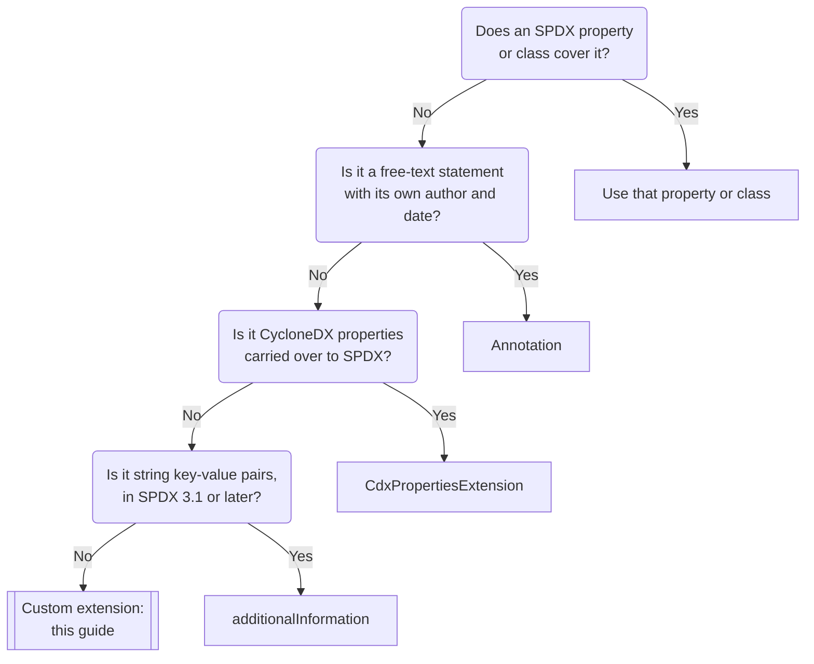
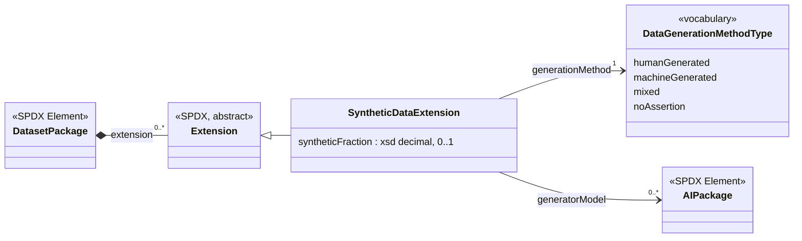
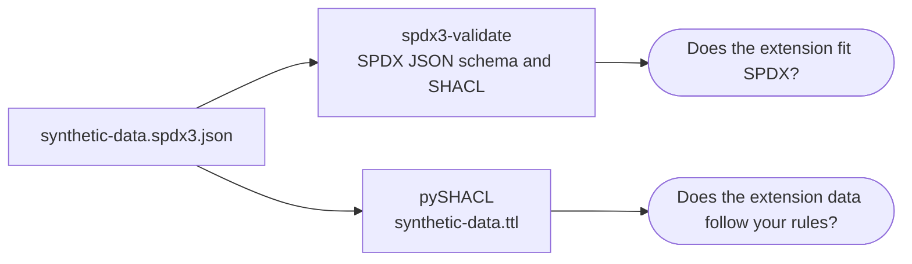

# Creating an SPDX 3 extension

This guide walks through creating a custom extension for SPDX 3: when to
create one, how to define it, how to write extension data in an SPDX 3 JSON
document, and how to validate it.

It uses a small example extension, *SyntheticData*, which records how the
content of a dataset was generated (by humans, by a machine, or both).

## Do you need an extension?

An extension adds information to an SPDX Element that the SPDX model has no
property for. Before creating one, check whether you can use something that
already exists:

1. **An existing SPDX property or class.** Check the profiles relevant to your
   data (Software, AI, Dataset, Security, and others). Ask on the SPDX mailing
   lists or open an issue in [spdx/spdx-3-model][spdx-3-model] if you are not
   sure.
2. **An [Annotation][Class_Annotation]**, for a free-text statement about an
   Element, with its own author and date.
3. **The [additionalInformation][Property_additionalInformation] property**
   (SPDX 3.1 and later), for simple key-value pairs where both key and value
   are strings. It is available on software artifacts, hardware, services,
   actions and processes. Use
   [additionalInformationSpecification][Property_additionalInformationSpecification]
   to point to the Specification that defines what the keys and values mean.
4. **A custom extension**, when you need structured data with its own types:
   values from a fixed list, numbers, dates, or references to other Elements.
   That is what this guide covers.

[CdxPropertiesExtension][Class_CdxPropertiesExtension] is not a general-purpose
option. It exists to carry CycloneDX `properties` (name-value pairs) into
SPDX, for example when converting a CycloneDX document. Use it only for that.



If the information would be useful to others, consider asking SPDX to add it
to the SPDX model as standard classes and properties, so that it no longer
needs an extension. A working extension is a good basis for such a request.

## Step 1: choose a namespace

Every class and property of your extension is identified by an IRI. Choose a
namespace IRI that you control, for example under your organization's domain:

```text
https://example.org/spdx3-ext/synthetic-data/
```

- Do not use `https://spdx.org/` or another organization's domain.
- Prefer a stable IRI. If you need to make incompatible changes later, put a
  version in the namespace (for example `.../synthetic-data/v2/`).
- Ideally, publish the definition of your extension at that IRI.

## Step 2: design the extension

An extension is a subclass of [Extension][Class_Extension] with its own
properties. Keep it small: one class with a few properties is easier for
others to understand and support.

The SyntheticData extension has five definitions:

| Definition | Kind | Range | Cardinality |
| --- | --- | --- | --- |
| `SyntheticDataExtension` | class, subclass of `Extension` | | |
| `generationMethod` | object property | `DataGenerationMethodType` | 1..1 |
| `DataGenerationMethodType` | vocabulary | `humanGenerated`, `machineGenerated`, `mixed`, `noAssertion` | |
| `syntheticFraction` | data property | `xsd:decimal`, 0 to 1 | 0..1 |
| `generatorModel` | object property | `ai_AIPackage` | 0..* |

How the extension fits into an SPDX document:



The extension object belongs to one Element (here, the DatasetPackage) through
that Element's `extension` property. It can refer to other Elements, such as
the AIPackage, by their `spdxId`.

Things to decide for each property:

- **Values from a fixed list**: define a vocabulary, with one IRI per entry.
  Include `noAssertion` (or `other`) if a producer may not know the answer.
- **Numbers, dates and other typed values**: choose an XML Schema datatype
  (`xsd:decimal`, `xsd:dateTime`, ...) and any limits.
- **References to SPDX Elements**: use an object property whose range is the
  SPDX class, and refer to the Element by its `spdxId`.
- **Cardinality**: which properties are required, and how many values each may
  have.
- **Several instances on one Element**: an Element may have more than one
  extension, also of the same class. Say whether that is allowed for your
  extension, and what it means.

An extension is not an Element: it has no `spdxId` and no `creationInfo`.
Attach each extension instance to one Element only, and leave it without an
`@id` (a blank node). If the information needs its own identity
or provenance, use an Element (for example an Annotation) instead.

## Step 3: write the definition

Write the definition of your extension in a machine-readable form, so that
tools can check data against it. Use OWL for the classes and properties, and
SHACL for the constraints, in the same style as the
[SPDX model](https://spdx.org/rdf/3.0.1/spdx-model.ttl).

```turtle
@prefix owl: <http://www.w3.org/2002/07/owl#> .
@prefix rdfs: <http://www.w3.org/2000/01/rdf-schema#> .
@prefix sh: <http://www.w3.org/ns/shacl#> .
@prefix xsd: <http://www.w3.org/2001/XMLSchema#> .
@prefix spdx-ext: <https://spdx.org/rdf/3.0.1/terms/Extension/> .
@prefix spdx-ai: <https://spdx.org/rdf/3.0.1/terms/AI/> .
@prefix sd: <https://example.org/spdx3-ext/synthetic-data/> .
@prefix sdgm: <https://example.org/spdx3-ext/synthetic-data/DataGenerationMethodType/> .

sd:SyntheticDataExtension a owl:Class, sh:NodeShape ;
    sh:targetClass sd:SyntheticDataExtension ;
    rdfs:subClassOf spdx-ext:Extension ;
    sh:property [
        sh:path sd:generationMethod ;
        sh:in ( sdgm:humanGenerated sdgm:machineGenerated sdgm:mixed sdgm:noAssertion ) ;
        sh:minCount 1 ; sh:maxCount 1 ] ,
    [
        sh:path sd:syntheticFraction ;
        sh:datatype xsd:decimal ;
        sh:minInclusive 0 ; sh:maxInclusive 1 ;
        sh:maxCount 1 ] ,
    [
        sh:path sd:generatorModel ;
        sh:class spdx-ai:AIPackage ] .

sd:DataGenerationMethodType a owl:Class .
sdgm:humanGenerated a owl:NamedIndividual, sd:DataGenerationMethodType .
sdgm:machineGenerated a owl:NamedIndividual, sd:DataGenerationMethodType .
sdgm:mixed a owl:NamedIndividual, sd:DataGenerationMethodType .
sdgm:noAssertion a owl:NamedIndividual, sd:DataGenerationMethodType .

sd:generationMethod a owl:ObjectProperty ; rdfs:range sd:DataGenerationMethodType .
sd:syntheticFraction a owl:DatatypeProperty ; rdfs:range xsd:decimal .
sd:generatorModel a owl:ObjectProperty ; rdfs:range spdx-ai:AIPackage .
```

Save it as `synthetic-data.ttl`. Add `rdfs:comment` descriptions to every
class, property and vocabulary entry.

The SPDX IRIs in it (`spdx-ext:`, `spdx-ai:`) are those of SPDX 3.0.1. SPDX
3.1 uses different IRIs, so a definition for 3.1 data needs its own copy.

`sh:class spdx-ai:AIPackage` is checked against the types in the data. A
reference to an AIPackage that is described in another document fails it,
unless that document is validated together with this one.

If you may later ask SPDX to add these classes and properties to the SPDX
model itself (as standard ones, no longer an extension), also write them in
the Markdown format of the [SPDX 3 model][spdx-3-model] (one file per class,
property and vocabulary). That is the format SPDX itself is written in.

## Step 4: use the extension in a document

The SPDX 3 JSON Schema requires `@context` to be exactly the SPDX context URL
(the specification text allows extra namespace mappings, but the schema does
not), and that context only defines SPDX terms. So in an extension object:

- `type` is the **full IRI** of the extension class.
- Property keys are **full IRIs**.
- A value that is a resource identified by an IRI (a vocabulary entry, or an
  Element) is written as `{"@id": "<IRI>"}`. A plain string is a text value,
  even if it looks like an IRI.
- A value with a datatype other than string, boolean or integer is written as
  `{"@value": "<value>", "@type": "<datatype IRI>"}`. For example, write a
  decimal as `{"@value": "0.35", "@type": "http://www.w3.org/2001/XMLSchema#decimal"}`.
  Per the JSON-LD 1.1 API, a JSON number is typed by its value: `0.35`
  becomes `xsd:double`, and `2.0` becomes `xsd:integer`.
- Write an integer as plain digits, such as `2`, not `2.0` or `2e0`, and use
  a value object for integers of 1e21 or more. Some tools, including rdflib
  (used by pySHACL), read `2.0` as `xsd:double`.
- A value that is itself an object of one of your classes is written as a
  nested object, with the same rules.
- The extension object is written inside the `extension` array of the Element
  it describes. The SPDX 3.0.1 JSON Schema does not accept it as a separate
  entry in `@graph`.

A complete document, where an AI model generated part of a dataset (save it
as `synthetic-data.spdx3.json`):

```json
{
  "@context": "https://spdx.org/rdf/3.0.1/spdx-context.jsonld",
  "@graph": [
    {
      "type": "CreationInfo",
      "@id": "_:creationinfo",
      "created": "2026-10-23T00:00:00Z",
      "createdBy": ["https://example.org/spdx/agent/alice"],
      "specVersion": "3.0.1"
    },
    {
      "type": "Person",
      "spdxId": "https://example.org/spdx/agent/alice",
      "name": "Alice Example",
      "creationInfo": "_:creationinfo"
    },
    {
      "type": "SpdxDocument",
      "spdxId": "https://example.org/spdx/doc/synthetic-data",
      "creationInfo": "_:creationinfo",
      "profileConformance": ["core", "software", "ai", "dataset"],
      "rootElement": ["https://example.org/spdx/dataset/instruct-mix"],
      "element": [
        "https://example.org/spdx/agent/alice",
        "https://example.org/spdx/model/teacher-llm",
        "https://example.org/spdx/dataset/instruct-mix",
        "https://example.org/spdx/rel/teacher-generates-dataset"
      ]
    },
    {
      "type": "ai_AIPackage",
      "spdxId": "https://example.org/spdx/model/teacher-llm",
      "name": "teacher-llm",
      "software_packageVersion": "2.1",
      "software_primaryPurpose": "model",
      "creationInfo": "_:creationinfo"
    },
    {
      "type": "dataset_DatasetPackage",
      "spdxId": "https://example.org/spdx/dataset/instruct-mix",
      "name": "instruct-mix",
      "software_packageVersion": "1.0",
      "software_primaryPurpose": "data",
      "dataset_datasetType": ["text"],
      "creationInfo": "_:creationinfo",
      "extension": [
        {
          "type": "https://example.org/spdx3-ext/synthetic-data/SyntheticDataExtension",
          "https://example.org/spdx3-ext/synthetic-data/generationMethod": {
            "@id": "https://example.org/spdx3-ext/synthetic-data/DataGenerationMethodType/mixed"
          },
          "https://example.org/spdx3-ext/synthetic-data/syntheticFraction": {
            "@value": "0.35",
            "@type": "http://www.w3.org/2001/XMLSchema#decimal"
          },
          "https://example.org/spdx3-ext/synthetic-data/generatorModel": {
            "@id": "https://example.org/spdx/model/teacher-llm"
          }
        }
      ]
    },
    {
      "type": "Relationship",
      "spdxId": "https://example.org/spdx/rel/teacher-generates-dataset",
      "from": "https://example.org/spdx/model/teacher-llm",
      "relationshipType": "generates",
      "to": ["https://example.org/spdx/dataset/instruct-mix"],
      "creationInfo": "_:creationinfo"
    }
  ]
}
```

The extension and standard SPDX work together here: the `generates`
Relationship says that the model produced the dataset, and the extension
describes the dataset itself.

### Do not list `extension` in `profileConformance` (SPDX 3.0.x)

In SPDX 3.0.0 and 3.0.1 JSON, the value `"extension"` in `profileConformance`
is expanded by JSON-LD to the `extension` property instead of the `extension`
profile, and fails validation. Writing the full IRI instead is rejected by the
JSON schema. Leave `extension` out of `profileConformance` until this is
fixed.

## Step 5: validate

Validation has two parts, and each checks something the other does not:



**SPDX.** Check the document against the SPDX model with
[spdx3-validate](https://github.com/JPEWdev/spdx3-validate):

```shell
spdx3-validate -s 3.0.1 -j synthetic-data.spdx3.json
```

This checks only that the extension fits SPDX (for example, that it is inside
an `extension` array and its `type` is an IRI, not an SPDX term). It does not
know your extension's rules.

Use SPDX 3.0.1 or later. The SPDX 3.0.0 SHACL shapes reject every custom
extension, so a document with one never passes 3.0.0 validation.

**Your extension.** Check the extension data against your SHACL shapes, for
example with [pySHACL](https://github.com/RDFLib/pySHACL), passing your
definition as both the shapes and the ontology:

```shell
pyshacl -s synthetic-data.ttl -e synthetic-data.ttl -df json-ld synthetic-data.spdx3.json
```

pySHACL fetches the SPDX JSON-LD context from the network to read the
document.

Test with documents that break your rules too (a missing required property, a
value out of range), and check that they are reported.

### Check that your tools keep the data

Not every SPDX tool supports custom extensions yet. Before you rely on a tool,
read a document with your extension and write it back, and check that:

- the tool does not reject the document;
- the extension object is still there, with the same `type` and keys;
- `{"@id": ...}` and `{"@value": ..., "@type": ...}` values are unchanged;
- the output still passes `spdx3-validate` and your SHACL check.

## Step 6: share the definition

- Publish your OWL/SHACL file, ideally at the namespace IRI, so users and
  validators can find it.
- Document each class, property and vocabulary entry for humans.
- Version it, and keep old versions available.
- If the extension fills a general gap in SPDX, propose in
  [spdx/spdx-3-model][spdx-3-model] that its classes and properties be added
  to the SPDX model, with your definition and examples.

## Summary

| Do | Do not |
| --- | --- |
| Use a namespace you control | Use `https://spdx.org/` or someone else's domain |
| Use full IRIs for the class and properties | Add your own mappings to `@context` |
| Write IRI values as `{"@id": ...}` | Write IRIs as plain strings |
| Write decimals and dates as `{"@value": ..., "@type": ...}` | Write decimals as JSON numbers |
| Put the extension inside the Element's `extension` array | Put it at the top level of `@graph` |
| Validate with spdx3-validate **and** your own SHACL | Rely on spdx3-validate alone |

[spdx-3-model]: https://github.com/spdx/spdx-3-model
[Class_Annotation]: https://spdx.github.io/spdx-spec/v3.0.1/model/Core/Classes/Annotation/
[Class_CdxPropertiesExtension]: https://spdx.github.io/spdx-spec/v3.0.1/model/Extension/Classes/CdxPropertiesExtension/
[Class_Extension]: https://spdx.github.io/spdx-spec/v3.0.1/model/Extension/Classes/Extension/
[Property_additionalInformation]: https://spdx.github.io/spdx-spec/v3.1-dev/model/Core/Properties/additionalInformation/
[Property_additionalInformationSpecification]: https://spdx.github.io/spdx-spec/v3.1-dev/model/Core/Properties/additionalInformationSpecification/
